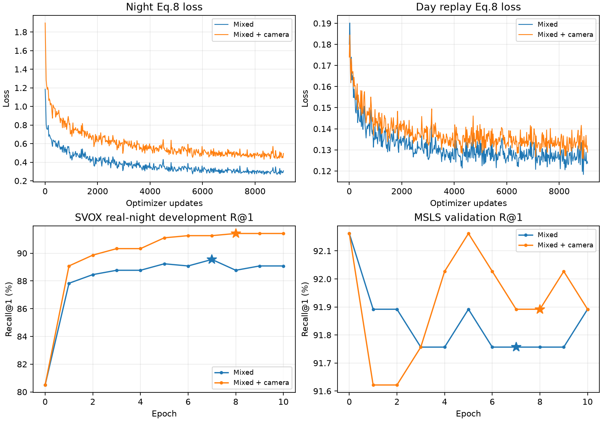

# Mixed 与 Mixed＋相机退化：已完成训练

本次核验历史完整训练记录，不重复训练，也不恢复归档方向。两组从同一原始模型开始，
固定 29,050 张训练夜图、1,529 张地点留出夜图，32 night＋32 day、10 轮、9,080 次更新。

| 方法 | 状态 | 最佳 epoch / step | SVOX night dev R@1 | MSLS val R@1 | Trainroom |
| --- | --- | ---: | ---: | ---: | --- |
| Mixed 日夜混合 | completed | 7 / 6356 | 89.5476 | 91.7568 | `539c22d03c8d` |
| Mixed＋相机退化 | completed | 8 / 7264 | 91.4197 | 91.8919 | `7fe91e0d309a` |

星号为实际选中权重；SVOX night dev 用于选模，MSLS 使用原有 1 pp 门槛。
Mixed＋相机退化只对学生夜图施加退化；白天回放、冻结教师目标和测试图片不额外退化。
测试集在选模后统一补测；不能由开发集收益代替各个夜间测试成绩。

原始论文复现为 15 轮 / 124,110 更新，使用其既有 epoch 9 best；任务 `223b8a23c9b2` 已完成。
全部曲线来源及完整训练结束标记的 SHA256 见 [training_summary.json](training_summary.json)。
